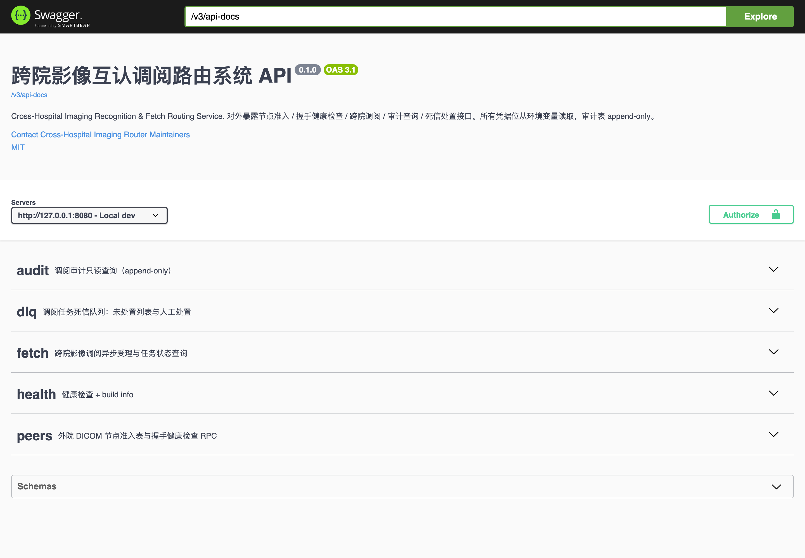
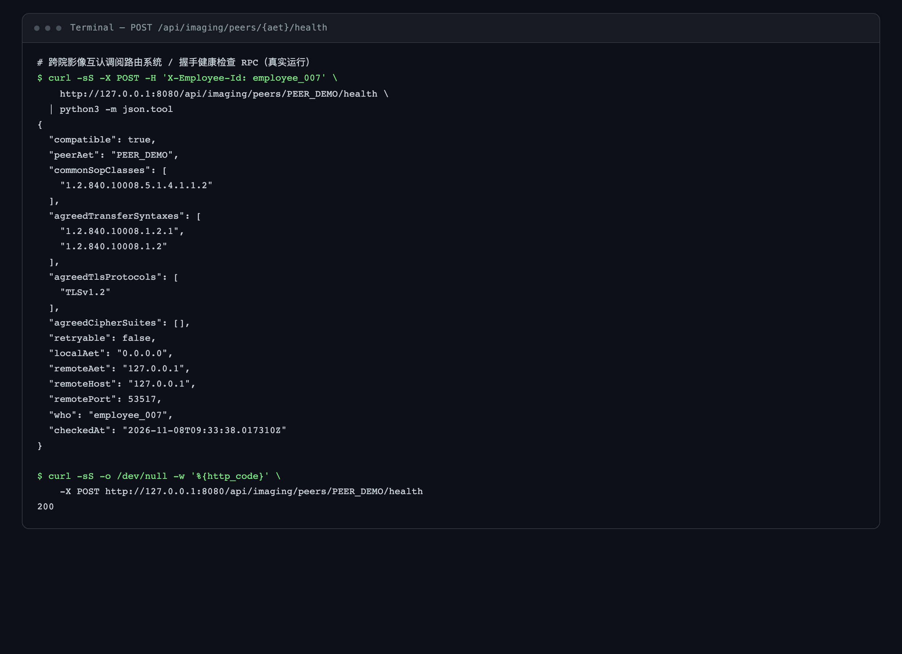
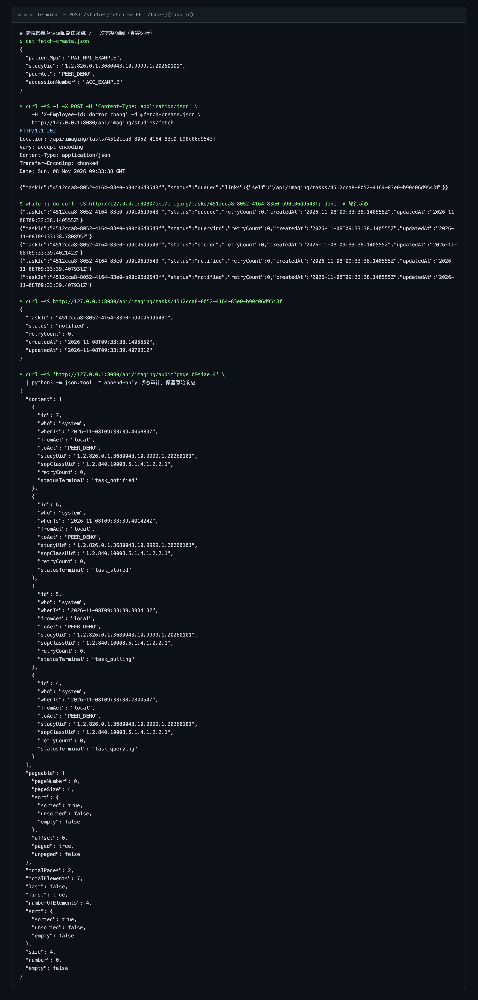

# 跨院影像互认调阅路由系统

> 临床医生在 HIS 工单一键发起调阅，10 分钟内把外院 DICOM 拉到本院 PACS，全程留痕可审计；AI 在互认初筛与报告归一处提供草稿，模型不可达时回退规则模板，不推进 PACS 写入。

跨院影像互认调阅路由系统是为多院区 / 医联体场景下「把外院 PACS 的影像快速、合规、可追溯地调到本院」设计的路由服务。
它在 DICOM TCP（11112）、WADO-RS HTTP、HL7 v2.x MLLP（6661）三条协议主路径上完成一次跨院调阅：
外院 HIS 发 `ORM^O01` 触发 → 本服务收帧 → DICOM C-FIND 询 StudyInstanceUID → C-MOVE 拉回 → C-STORE 写本院 PACS →
HIS webhook 通知医生 → 全程 append-only 审计链。AI 仅在「报告归一 / 互认初筛」两处介入，模型不可达时回退规则模板。

## 适用场景 / 目标岗位

| 岗位 | 什么时候用 | 得到什么 |
|------|------------|----------|
| 信息科 / 集成工程师 | 接一家新外院 PACS 节点 | 用一个 API 写入准入配置 + 一次握手 RPC 验证兼容性，1 天内完成接入 |
| 临床医生 | HIS 工单一键发起跨院调阅 | 异步拿到调阅任务 ID，10 分钟内在本院 PACS 工作站看到外院影像 |
| 影像科技师 | 排查跨院调阅异常 | 查审计日志按时间窗 / 来源 AET / 状态码定位断点 |
| 影像科医生 | 在 PACS 工作站复核外院报告 | 看到 AI 草稿的互认初筛意见与归一后的报告文本，逐项人工确认 |

> **表格纪律**：本表只写岗位口语 + 业务时刻 + 可核对产出；DICOM / HL7 / WADO-RS 协议细节一律放到「命令 / API / 配置说明」。

## 能力要点

- **DICOM 主路径**：C-FIND 询 StudyInstanceUID → C-MOVE 拉回 → C-STORE 写本院 PACS，三步连贯，握手阶段先做传输语法与 SOP Class 协商。
- **跨协议触发**：HIS 经 HL7 v2.x MLLP 推 `ORM^O01`，本服务收帧解析后自动入队调阅任务，无需医生手工发起。
- **可审计**：每次握手、调阅、通知、状态推进、配置变更都进 append-only 审计表，链式 SHA-256 校验和防篡改。
- **可降级**：AI 报告归一 / 互认初筛走 `ModelGateway`，模型不可达 / 超时 / 解析失败 / 输出被截断时自动回退规则模板（来源标记 `rule_fallback`），**不推进 PACS 写入、也不阻断调阅完成通知** —— 影像已经在本院 PACS 里，AI 只是给医生的草稿。
- **不重复受理**：同一病人同一次检查，HIS 重投、医生连点、并发触发都只落一条调阅任务并返回同一个任务号 —— 外院影像不会被拉两遍，本院 PACS 不会进两份同样的片子。
- **可重试**：按失败码决定是否重试（指数退避 + ±25% 抖动），重试耗尽进死信 + 告警 webhook，信息科可在 DLQ API 处置。
- **可观测**：结构化 JSON 日志（带 `traceId` / `who` / `taskId`），Micrometer + Prometheus 指标暴露 `/actuator/prometheus`。

## 快速开始

### 依赖

- Java 17（OpenJDK / Temurin；本项目实测构建环境用 JDK 27 也能编译通过）
- Maven 3.9+（仓库内 `./mvnw` 是本机 Maven 的**薄封装**，不带 Maven 发行包，仍需先装 Maven）
- PostgreSQL 14+（本服务默认 `localhost:5432`，凭据从环境变量读；测试用内嵌 PostgreSQL，无需本机装库或 Docker）
- 可选：Docker（用于本地一键起 PostgreSQL）

### 安装

```bash
git clone <repo-url>
cd cross-hospital-imaging-router
./mvnw -DskipTests package
```

### 配置

复制示例环境变量，按本机情况修改：

```bash
cp .env.example .env
# 编辑 .env：DATABASE_URL / WADO_RS_BEARER_TOKEN / LOCAL_PACS_* / MODEL_API_KEY 等
```

> 凭据一律从环境变量读取，源码不硬编码任何密钥。`.env` 已被 `.gitignore` 排除。

### 构建与验证

```bash
./mvnw -DskipTests package                # 编译 + 打 jar
./mvnw spring-boot:run                    # 启动服务（默认 8080）
curl -sS http://127.0.0.1:8080/actuator/health    # 期望 {"status":"UP"}
curl -sS http://127.0.0.1:8080/v3/api-docs | head  # 期望返回 OpenAPI JSON
```

### 主命令速查

```bash
./mvnw spring-boot:run                    # 启动服务
./mvnw test                               # 跑全部单元 + 集成测试
./mvnw -DskipTests package                # 编译打包
./mvnw spring-boot:run -Dspring-boot.run.profiles=mock   # 跑 mock profile（不发真协议）
./scripts/generate-fixtures.sh             # 重新下载公开数据集样例
```

## 命令 / API / 配置说明

### 关键配置项

| 配置项 | 默认值 | 说明 |
|--------|--------|------|
| `DATABASE_URL` | `jdbc:postgresql://localhost:5432/imaging_router` | PostgreSQL JDBC URL |
| `DATABASE_USER` / `DATABASE_PASSWORD` | `imaging` / （空） | 数据库账号，凭据从环境变量读 |
| `DICOM_PEERS_JSON` | （空） | 外院 PACS 准入配置 JSON 数组：aet / host / port / tls_mode / present_contexts / transfer_syntaxes / blacklist_aets |
| `WADO_RS_URL_TEMPLATE` | `http://localhost:8081/wado/studies/{studyUid}` | 外院 WADO-RS 拉取 URL 模板 |
| `WADO_RS_BEARER_TOKEN` | （空） | WADO-RS 鉴权 token，从环境变量读 |
| `LOCAL_PACS_HOST` / `LOCAL_PACS_PORT` / `LOCAL_PACS_AET` | `127.0.0.1` / `11112` / `LOCAL_PACS` | 本院 PACS 网络地址 |
| `LOCAL_AET` / `LOCAL_AET_HOST` / `LOCAL_AET_BIND_PORT` | `IMAGER` / `0.0.0.0` / `-1` | 本服务作 SCU 时的 AE Title（**必须 ≤ 16 字符**，DICOM 协议栈在建关联时校验）；`-1` = 不监听 |
| `DICOM_REMOTE_CONNECT_TIMEOUT_MS` / `DICOM_TLS_PROTOCOLS` / `DICOM_TLS_CIPHER_SUITES` | `15000` / `TLSv1.3,TLSv1.2` / （空） | 远端连接超时与 TLS 协商白名单；cipher 留空 = 不启用 TLS |
| `ROUTING_QUERY_TIMEOUT_MS` / `ROUTING_RETRIEVE_TIMEOUT_MS` / `ROUTING_STORE_TIMEOUT_MS` | `30000` / `120000` / `60000` | 三步协议各自的超时预算 |
| `HL7_TRIGGER_PORT` / `HL7_LOCAL_APPLICATION` / `HL7_LOCAL_FACILITY` | `6661` / `IMAGER` / `LOCAL_HOSP` | MLLP 守护端口与本地标识 |
| `HIS_WEBHOOK_URL` | （空） | 调阅任务到 `notified` 时通知 HIS 的回调地址 |
| `DLQ_ALERT_WEBHOOK_URL` | （空） | 死信告警外发地址（钉钉 / 企业微信 / 院内告警网关）；留空 = 只落库不推告警 |
| `DLQ_ALERT_COOLDOWN_MINUTES` | `10` | 同一失败码的告警冷却窗口（分钟）：一次外院断网会同时产生几十条同码死信 |
| `DLQ_RETENTION_DAYS` | `30` | 已处置死信保留天数；**未处置的死信永不自动清理** |
| `MODEL_BASE_URL` / `MODEL_API_KEY` / `MODEL_NAME` / `MODEL_TIMEOUT_MS` | （空）/（空）/ `gpt-4o-mini` / `5000` | OpenAI-compatible 模型网关配置 |
| `model.fallback.enabled` | `true` | 模型不可达时是否允许回退规则模板；置 `false` 则直接失败（不产出草稿） |
| `model.fallback.templates-path` | `classpath:hl7/segment-mappings.yml` | 规则**词典**位置：模态映射、兜底文案、互认判据（信息科可直接改这个文件） |
| `model.fallback.rule-templates-path` | `classpath:hl7/rule-templates.json` | 规则模板**骨架**位置：输出字段与渲染指令 |

### CLI 子命令 / 接口端点

| 命令或路径 | 用途 | 关键参数 |
|------------|------|----------|
| `POST /api/imaging/peers` | 登记外院 PACS 节点 | aet / host / port / tls_mode / present_contexts / transfer_syntaxes / blacklist_aets |
| `GET /api/imaging/peers` | 分页查询准入节点 | page / size |
| `GET /api/imaging/peers/{aet}` | 查询单个节点 | （路径参数 aet） |
| `PUT /api/imaging/peers/{aet}` | 更新准入配置 | 同创建 |
| `DELETE /api/imaging/peers/{aet}` | 注销节点 | （路径参数 aet） |
| `POST /api/imaging/peers/{aet}/health` | 端到端握手 RPC | （路径参数 aet） |
| `POST /api/imaging/studies/fetch` | 异步发起跨院调阅 | patientMpi / studyUid / sopClassUid? / accessionNumber? / peerAet? |
| `GET /api/imaging/tasks/{task_id}` | 查询调阅任务状态 | （路径参数 task_id） |
| `GET /api/imaging/audit` | 审计查询（多条件） | from / to / fromAet / toAet / statusTerminal / who / page / size |
| `GET /api/imaging/dlq` | 未处置死信分页查询（按创建时间倒序） | page / size / failureCode? |
| `GET /api/imaging/dlq/{id}` | 单条死信详情（含任务上下文） | （路径参数 id） |
| `POST /api/imaging/dlq/{id}/resolve` | 标记 DLQ 已处置（落 `dlq_resolved` 审计行） | （路径参数 id）+ 请求体 note? |
| `GET /actuator/health` / `/actuator/info` / `/actuator/prometheus` | 健康 / 信息 / Prometheus 指标 | 无 |
| `GET /swagger-ui.html` / `/v3/api-docs` | OpenAPI 文档 | 无 |

### 错误与降级

| 场景 | 表现 | 处理方式 |
|------|------|----------|
| 模型网关超时（> 5s） | HTTP 504 + `code=model_timeout` | 落 `ai_call_audit` 失败行（`status=timeout`）；回退规则模板，草稿来源标 `rule_fallback`；**不阻断** notified 推进 |
| 模型网关不可达（未配置 / 连不上 / 4xx / 5xx） | HTTP 502 + `code=model_unreachable` | 同上，审计 `status=unreachable`（拿到 HTTP 响应时为 `http_error`） |
| 模型返回非法 JSON / 不合 schema | HTTP 502 + `code=model_response_invalid` | 同上，审计 `status=parse_error` |
| 模型回话不完整（`finish_reason=length` 截断 / `content_filter` 拦截） | HTTP 502 + `code=model_response_invalid`（`parse_error=INCOMPLETE_OUTPUT`） | 同上；不重试（重发还是被截），草稿回退规则模板 |
| 模型失败**且**规则模板也用不了（缺模板 / 兜底开关关闭 / 兜底产物不合 schema） | HTTP 502 + `code=model_unreachable` | 不产出草稿：`ai_summary_id` 保持为空；任务照常推进到 `notified`，审计终态仍是 `task_notified`（不写失败码） |
| 外院 PACS 拒接 | `code=connection_refused` | 按 peer.max_retries 重试（指数退避 + ±25% 抖动），耗尽进死信 |
| 传输语法无交集 | `code=transfer_syntax_empty` | 不重试，落审计 + 死信 + 告警 webhook |
| 黑白名单命中 | `code=blacklisted_rejected` | 不重试，落审计 + 死信 + 告警 webhook |
| 同一 (patient_mpi, study_uid) 在调阅中 | 返回现有 task_id（HTTP 200，不新建任务） | 幂等键 `(patient_mpi, study_uid)`；并发下由数据库唯一约束兜底，落败方复用先落库者的 task_id |
| HIS webhook 不可达 | `code=webhook_failed` | 重试 3 次，耗尽落 `dlq_notification` + 告警 |
| 死信告警网关不可达 | 死信照落库，`alert_webhook_sent=false` | 降级为日志告警；不因告警失败影响调阅流程 |
| 同码死信连续发生 | 冷却窗口内只推第一条告警 | 其余只落库（避免一次外院断网把值班手机震几十遍） |
| 死信被重复处置 | HTTP 409 + `code=conflict` | 第一次处置的记录不被覆盖 |

### 对接现有系统

| 对端 | 协议 | 端口 / 路径 | 凭据来源 |
|------|------|------------|----------|
| 外院 PACS / 影像设备 | DICOM TCP（Q/R + Storage SOP Class） | 远端 11112 | `DICOM_PEERS_JSON` 配置项 |
| 区域 PACS 检索网关 | WADO-RS HTTP（multipart/related） | `WADO_RS_URL_TEMPLATE` | `WADO_RS_BEARER_TOKEN` 环境变量 |
| 本院 HIS（接收 ORM 触发） | HL7 v2.x MLLP TCP | 本地 6661 | 无（受信内网） |
| 本院 PACS（写入） | DICOM TCP（C-STORE） | `LOCAL_PACS_HOST:LOCAL_PACS_PORT` | 本地配置，无凭据 |
| 本院 HIS（结果回调） | HTTP webhook | `HIS_WEBHOOK_URL` | 由 HIS 侧维护，本服务侧只发起 POST |
| 模型服务（OpenAI-compatible） | HTTPS HTTP | `MODEL_BASE_URL` | `MODEL_API_KEY` 环境变量 |

## 典型场景

### 场景 1：信息科接入一家新外院 PACS

1. 拿到外院 PACS 的 AET / IP / 端口 / TLS 模式 / 支持的传输语法与 SOP Class。
2. 调 `POST /api/imaging/peers` 登记准入配置（含 `blacklist_aets` 隔离名单）。
3. 调 `POST /api/imaging/peers/{aet}/health` 跑握手 RPC，验证协议兼容。
4. 若 `compatible=false`，查响应中 `lastError` 字段定位不兼容项（传输语法 / TLS / 黑名单）。
5. 审计表新增 4 行（create_peer / handshake / 4 次五态回调各一行）。

```bash
curl -sS -X POST http://127.0.0.1:8080/api/imaging/peers \
  -H 'Content-Type: application/json' \
  -d '{"peerAet":"OUT_PACS","host":"10.0.0.5","port":11112,"tlsMode":"required","transferSyntaxes":["1.2.840.10008.1.2.1"]}'
curl -sS -X POST http://127.0.0.1:8080/api/imaging/peers/OUT_PACS/health
```

### 场景 2：临床医生一键发起跨院调阅

1. 医生在 HIS 工单选「跨院调阅」，HIS 内部拼 `ORM^O01` 经 MLLP 推到本服务 6661。
2. 本服务 MLLP 守护收帧 → HL7Parser 抽 `PID-3`（MPI）+ `OBR-3`（study UID）→ 入队 FetchTask。
3. FetchTaskService 五态机推进：`queued` → `querying` → `pulling` → `stored` → `notified`。
4. C-FIND 询外院 PACS → C-MOVE 拉回 → C-STORE 写本院 PACS → 推 HIS webhook。
5. 医生在 PACS 工作站看到影像；AI 互认初筛草稿与归一报告并存，医生逐项人工确认。

```bash
# 模拟 HIS 触发（用 netcat 推 MLLP 帧；真实场景由 HIS 自动推）
printf '\x0bMSH|^~\\&|HIS|HOSP|IMAGER|LOCAL_HOSP|20261020||ORM^O01|MSG-001|P|2.5\rPV1||O|...\r\x1c\x0d' | nc 127.0.0.1 6661
# 查询任务状态
curl -sS http://127.0.0.1:8080/api/imaging/tasks/<EXAMPLE_TASK_ID>
```

### 场景 3：影像科医生查看审计与互认草稿

1. 医生在 PACS 工作站看外院影像，同时看 AI 互认初筛草稿（`source=model` 或 `source=rule_fallback`）。
2. 调 `GET /api/imaging/audit?fromAet=OUT_PACS&statusTerminal=stored` 看历史调阅。
3. 调 `GET /api/imaging/dlq` 看死信；调 `POST /api/imaging/dlq/{id}/resolve` 标记处置完成。
4. 医生对互认初筛草稿逐项人工确认；AI 输出**不**自动写入 PACS / EMR。

```bash
curl -sS 'http://127.0.0.1:8080/api/imaging/audit?fromAet=OUT_PACS&statusTerminal=stored&size=20'
curl -sS 'http://127.0.0.1:8080/api/imaging/dlq?size=20'
```

## 输出样例

以下前三段是 `docs/screenshots/` 那次真实运行里逐字抄回的响应（只做缩进排版，字段与数值未改）。

### 握手 health RPC JSON 样例

```json
{
  "compatible": true,
  "peerAet": "PEER_DEMO",
  "commonSopClasses": ["1.2.840.10008.5.1.4.1.1.2"],
  "agreedTransferSyntaxes": ["1.2.840.10008.1.2.1", "1.2.840.10008.1.2"],
  "agreedTlsProtocols": ["TLSv1.2"],
  "agreedCipherSuites": [],
  "retryable": false,
  "localAet": "0.0.0.0",
  "remoteAet": "127.0.0.1",
  "remoteHost": "127.0.0.1",
  "remotePort": 53517,
  "who": "employee_007",
  "checkedAt": "2026-11-08T09:33:38.017310Z"
}
```

> `remotePort` 是本次运行由操作系统分配的本地 SCP 端口，复现时会变。

### 调阅任务状态 JSON 样例

受理回执（`POST /api/imaging/studies/fetch` → 202 + Location）：

```json
{"taskId":"4512cca8-8052-4164-83e0-b90c06d9543f","status":"queued","links":{"self":"/api/imaging/tasks/4512cca8-8052-4164-83e0-b90c06d9543f"}}
```

终态（`GET /api/imaging/tasks/{task_id}`）：

```json
{
  "taskId": "4512cca8-8052-4164-83e0-b90c06d9543f",
  "status": "notified",
  "retryCount": 0,
  "createdAt": "2026-11-08T09:33:38.140555Z",
  "updatedAt": "2026-11-08T09:33:39.407931Z"
}
```

> 任务成功终态不返回 `failureCode` / `aiSummaryId`（Jackson 全局 `non_null` 序列化）。
> AI 产物落在 `ai_summaries` 表，不在状态响应里展开。

### 审计查询 JSON 样例

```json
{
  "content": [
    {
      "id": 7, "who": "system", "whenTs": "2026-11-08T09:33:39.405839Z",
      "fromAet": "local", "toAet": "PEER_DEMO",
      "studyUid": "1.2.826.0.1.3680043.10.9999.1.20260101",
      "sopClassUid": "1.2.840.10008.5.1.4.1.2.2.1",
      "retryCount": 0, "statusTerminal": "task_notified"
    },
    {
      "id": 6, "who": "system", "whenTs": "2026-11-08T09:33:39.401424Z",
      "fromAet": "local", "toAet": "PEER_DEMO",
      "studyUid": "1.2.826.0.1.3680043.10.9999.1.20260101",
      "sopClassUid": "1.2.840.10008.5.1.4.1.2.2.1",
      "retryCount": 0, "statusTerminal": "task_stored"
    }
  ],
  "pageable": {"pageNumber": 0, "pageSize": 2, "sort": {"sorted": true, "unsorted": false, "empty": false}, "offset": 0, "paged": true, "unpaged": false},
  "totalPages": 4, "totalElements": 7, "last": false, "first": true,
  "numberOfElements": 2, "size": 2, "number": 0, "empty": false,
  "sort": {"sorted": true, "unsorted": false, "empty": false}
}
```

> 响应刻意不暴露 `rowChecksum` / `prevChecksum`；链式校验和只在库内用于防篡改自检。

### AI 报告归一草稿样例

> **本节是结构示意，不是上面那轮实测的产出**：实测环境没有登记 `external_study_materials`
> 里的外院报告原文，两个 AI 介入点按设计不臆造内容、`ai_summary_id` 保持为空。
> 下面给出的是同一个 JSON Schema 下的合法载荷形状，便于前端对接。

```json
{
  "taskId": "<EXAMPLE_TASK_ID>",
  "kind": "report_normalize",
  "source": "model",
  "model": "gpt-4o-mini",
  "payload": {
    "bodyPart": "胸部",
    "findings": "双肺纹理清晰，未见实变",
    "impression": "胸部 CT 平扫未见明显异常",
    "studyItems": ["胸部 CT 平扫"]
  },
  "latencyMs": 482
}
```

### 模型不可达时的规则兜底草稿样例

模型服务没配 / 连不上 / 超时 / 返回读不懂时，同一个介入点改由规则模板产出，
**载荷形状与模型路径完全一致**，只有 `source` 不同 —— 医生一眼能分清这份草稿是模型判的还是规则凑的：

```json
{
  "taskId": "<EXAMPLE_TASK_ID>", "kind": "report_normalize", "source": "rule_fallback",
  "model": "gpt-4o-mini", "latencyMs": 3,
  "fallbackReason": "模型服务不可达：model.base-url 未配置（环境变量 MODEL_BASE_URL）",
  "payload": {
    "bodyPart": "胸部", "findings": "外院报告未提供影像所见描述",
    "impression": "外院报告未提供诊断意见", "studyItems": ["外院检查"]
  }
}
```

> 外院没给的内容写明「未提供」，**不臆造**；兜底文案与模态映射写在
> `src/main/resources/hl7/segment-mappings.yml` 的 `model-fallback` 段，信息科可直接改。

### 实测截图采集方式

`docs/screenshots/` 下三张图都来自一次真实运行：真 PostgreSQL（V1–V10 迁移原样跑一遍）、真 DICOM SCP、真 Spring Boot Web 容器（8080）。采集脚本 `scripts/capture-evidence.sh` 调用 `scripts/capture_evidence.py`，用无头 Chromium 打开 Swagger UI，并用真实 `curl` 打接口；02 / 03 两张是把**真实 curl 命令与真实 stdout** 按终端配色逐字渲染成 PNG，只做 `python3 -m json.tool` 缩进，不改字段与数值。

```bash
# 1) 起真实服务（内嵌 PostgreSQL + 真 DICOM SCP，不装 Docker）
mvn -o -q test-compile
mvn -o -q dependency:build-classpath \
  -Dmdep.outputFile=target/runtime-cp.txt -Dmdep.includeScope=test
java -cp "target/classes:target/test-classes:$(cat target/runtime-cp.txt)" \
  com.crosshospital.imaging.tools.RealRuntimeLauncher &
# 2) 等 target/evidence-runtime/READY 出现后采集
bash scripts/capture-evidence.sh
# 3) 采集完停掉后台服务
```

采集用的 DICOM / HL7 / WADO-RS fixture 全是自造示例 UID（`1.2.826.0.1.3680043.10.9999.*`），不含任何可回溯到真实患者的标识。

## 概念 / 实测对照

### 视觉目标

`docs/concepts/visual-target.md` 是结构化视觉目标卡：起始态（Swagger UI 空服务）、首个可用瞬间（一次握手 health RPC 返回 JSON）、成形态（一次完整调阅任务五态推进 + AI 草稿回执）。配色 / 间距 / 字体层级按 design token 集中管理，色板偏中性蓝灰（`#0F172A` 主色 / `#E5E7EB` 中性灰），信息密度中等。

### 实测证据







> **诚实标注**：**上 / 左是视觉目标**（`docs/concepts/visual-target.md` 的结构化目标卡，中性蓝灰 `#0F172A` 主色），**下 / 右是实测截图**。两者不一致，差距写在这里：
>
> 1. Swagger UI 用的是 springdoc 默认主题（绿黑配色、Swagger 官方 logo），没有实现目标卡里的院内蓝灰视觉规范；本轮只交付文档契约，不做前端换肤。
> 2. 目标卡预设「一次握手 RPC 返回 JSON」与「五态推进」是独立画面，实测把它们压进同一张终端长图；`03` 的状态轮询只拍到 `queued → querying → stored → notified`，`pulling` 因两次轮询之间已完成而没被 curl 捕获，但同一张图底部的 append-only 审计 JSON 里 `task_querying / task_pulling / task_stored / task_notified` 四行齐全，可逐行核对。
> 3. 实测响应里的 `remotePort` 是操作系统动态分配的本地端口，`taskId` 是本次运行的真实 UUID，每次复现都会变；所有患者相关标识仍是脱敏占位值。
> 4. 02 / 03 是终端会话输出的忠实渲染（无头 Chromium 按终端配色排版），不是设计稿，也不是概念图；命令与 JSON 逐字来自真实 stdout。

## 架构与数据流

```
                          ┌───────────────────────────┐
                          │  外院 HIS（HL7 v2.x MLLP） │
                          │  ORM^O01 → 127.0.0.1:6661 │
                          └────────────┬──────────────┘
                                       │ MLLP 帧
                                       ▼
        ┌──────────────────────────────────────────────────────┐
        │  MllpTriggerService  +  HL7Parser（HL7 v2.x 段解析）     │
        │  抽 PID-3 + OBR-3 → 入队 FetchTask（幂等键）             │
        └────────────────────────┬─────────────────────────────┘
                                 │
                                 ▼
        ┌──────────────────────────────────────────────────────┐
        │  FetchTaskService 五态机（queued → querying → pulling │
        │  → stored → notified | failed）                       │
        └────────────────────────┬─────────────────────────────┘
                                 │
                                 ▼
        ┌──────────────────────────────────────────────────────┐
        │  DicomRoutingService（DICOM 上层协议栈）              │
        │  ① C-FIND  → StudyInstanceUID 列表                   │
        │  ② C-MOVE  → 拉回 DICOM 字节流                       │
        │  ③ C-STORE → 写本院 PACS（LOCAL_PACS_AET）            │
        │                                                       │
        │  WADO-RS 旁路：HTTP multipart/related 拉取             │
        └────────────────────────┬─────────────────────────────┘
                                 │
                                 ▼
        ┌──────────────────────────────────────────────────────┐
        │  ModelGateway（OpenAI-compatible）                    │
        │  ① ReportNormalizationService（报告归一）             │
        │  ② FeasibilityScreenerService（互认初筛）             │
        │  失败时回退规则模板（hl7/segment-mappings.yml +        │
        │  rule-templates.json），source=rule_fallback          │
        └────────────────────────┬─────────────────────────────┘
                                 │
                                 ▼
        ┌──────────────────────────────────────────────────────┐
        │  AuditService（append-only + 链式 SHA-256）           │
        │  HisWebhookNotifier（status=notified → POST HIS）      │
        └──────────────────────────────────────────────────────┘
```

### 关键不变量

- **幂等键**：`(patient_mpi, study_uid)` 在 `status ∈ {queued, querying, pulling, stored}` 范围内拒绝重复入队；PostgreSQL `UNIQUE` 约束做最后防线。
- **一次入队只占一条连接**：任务行在独立事务里提交后立刻归还连接，入队方法本身不开外层事务 —— 并发受理量按连接池大小正常排队，不会把池子抽干后集体卡到 `connection-timeout`。
- **状态机**：FetchTask 五态机 + 非法跃迁清单（如 `stored → querying` 拒绝），`TaskStatus.canTransitionTo` 校验。
- **审计 append-only**：`audit_imaging_fetch` 表由 PostgreSQL 触发器禁 UPDATE/DELETE；链式 SHA-256 校验和防篡改。
- **审计查询不静默少给行**：翻页浏览单页最多 500 行；导出材料（一次性整取）最多 50000 行。**要多少行就得拿到多少行** —— 导出少给行而不报错，等于交上去的飞检材料是缺的。
- **失败不静默改数据**：DICOM 路由失败进死信 + 告警 webhook；AI 调用失败 `ai_summary_id` 留空、`source` 标注 `rule_fallback`，任务状态不变。
- **重试退避**：指数退避 `1s → 2s → 4s → 8s → 16s → 30s` 封顶 + ±25% 抖动；超过 `peer.max_retries` 进死信。

## 安全与合规边界

> 本节仅适用于涉及临床辅助决策 / AI 诊疗建议 / 自动写入临床系统的产品。本系统管的是影像传输与调阅路由，AI 输出仅作互认初筛与报告归一草稿，**不**自动写 EMR / PACS 影像标注 / 诊断结论。

- **AI 输出仅作草稿**：互认初筛与归一报告由影像科医生在 PACS 工作站逐项人工复核，AI 输出不自动推进临床状态。
- **凭据隔离**：所有密钥（DB / WADO-RS / 模型 API key）一律从环境变量读，源码不硬编码；`.env` 已被 `.gitignore` 排除。
- **审计可追溯**：每次协议握手 / 调阅任务 / 配置变更 / 模型调用都落 `audit_imaging_fetch` 与 `ai_call_audit` 两表。
- **脱敏替身**：测试数据用 `<EXAMPLE_TASK_ID>` / `<EXAMPLE_STUDY_UID>` / `<EXAMPLE_MPI>` 等占位符，不连真实患者数据库。

## 验收与自检

| 验收项 | 命令 | 期望结果 |
|--------|------|----------|
| 服务可启动 | `./mvnw spring-boot:run` | 进程监听 8080；`/actuator/health` 返回 `{"status":"UP"}` |
| OpenAPI 文档可访问 | `curl -sS http://127.0.0.1:8080/v3/api-docs` | 返回合法 OpenAPI 3.1 JSON |
| 握手 RPC | `POST /api/imaging/peers/{aet}/health` | 返回 `compatible=true` 或带明确 `lastErrorCode` / `lastErrorMessage` / `retryable` |
| 调阅异步入口 | `POST /api/imaging/studies/fetch` | 202 Accepted + `taskId` |
| 任务状态推进 | `GET /api/imaging/tasks/{task_id}` | 五态机按 `queued → querying → pulling → stored → notified` 推进 |
| 审计 append-only | `psql -c "DELETE FROM audit_imaging_fetch WHERE id=1"` | 数据库报错（触发器拦截） |
| 审计链完整性自检（无需自备 PostgreSQL） | `mvn test -Dtest=AuditAppendOnlyPostgresTest` | 8 例通过：真 PostgreSQL 里链式校验和逐行接得上；UPDATE / DELETE / TRUNCATE 均被触发器拒绝；整取（导出）不被单页上限截断 |
| AI 不可达降级 | 断网跑 fetch | `ai_summaries.source='rule_fallback'`，任务仍推进到 notified |
| Prometheus 指标 | `curl /actuator/prometheus` | 包含 `imaging_fetch_total` / `ai_call_total` / `dcm_handshake_total` 等 8 个业务指标 |
| 真库 JSONB 写入 | `mvn test -Dtest=PeerJsonbPostgresTest` | 3 个 JSONB 列能落库、`pg_typeof` 为 `jsonb`、按 JSON 路径可读回；防 `42804` 复发 |
| 配置键位真实生效 | `mvn test -Dtest=DicomConfigPropsBindingTest` | 扁平键能绑定、默认 AET 长度 ≤ 16、旧嵌套键不再悄悄覆盖 |
| 五态机推到终态 | `mvn test -Dtest=FetchTaskRunnerTest` | 流水线推到 `notified`，且 `NotificationPort` 真的被调用一次 |
| 统一错误码 | `mvn test -Dtest=GlobalExceptionHandlerErrorCodeTest` | 6 类异常分别映射 502 / 409 / 507 / 401 / 422，响应含 `code` + `retryable` + `traceId` |

## 项目结构

```
cross-hospital-imaging-router/
├── README.md                                  # 本文件（中文产品说明，含实测证据与诚实标注）
├── README_EN.md                               # 英文概览（指向本文件为权威文档）
├── LICENSE                                    # MIT 许可证
├── mvnw                                       # 本机 Maven 的薄封装（不自带发行包）
├── pom.xml                                    # Maven 配置（Spring Boot 3 + DICOM/HL7 协议栈 + springdoc）
├── .gitignore                                 # 排除 target/ .env logs/ score.json 等
├── .env.example                               # 凭据配置样例（无真实密钥）
├── qrcode.jpg                                 # 公众号二维码
├── docs/
│   ├── concepts/
│   │   └── visual-target.md                   # 结构化视觉目标卡（设计意图，非实测）
│   └── screenshots/
│       ├── 01-swagger-ui.png                  # 真实浏览器渲染的 Swagger UI
│       ├── 02-handshake-curl.png              # 真实 curl 会话：握手 RPC JSON
│       └── 03-fetch-task-status.png           # 真实 curl 会话：五态推进 + 审计
├── scripts/
│   ├── generate-fixtures.sh                   # 公开数据集样例下载脚本（含断网降级）
│   ├── capture-evidence.sh                    # 真实运行截图采集入口
│   └── capture_evidence.py                     # 采集实现（curl + 无头 Chromium 渲染）
├── src/
│   ├── main/
│   │   ├── java/com/crosshospital/imaging/    # 主代码（domain / service / api / config / repository / exception / scheduled / security / model / metrics）
│   │   └── resources/
│   │       ├── application.yml                # Spring Boot 配置（扁平键位，与配置类字段一一对应）
│   │       ├── hl7/segment-mappings.yml       # HL7 段位置白名单 + 规则回退词典（模态映射 / 兜底文案 / 互认判据）
│   │       ├── hl7/rule-templates.json        # 规则模板骨架（输出字段与渲染指令）
│   │       ├── logback-spring.xml             # JSON 结构化日志（含 MDC 字段）
│   │       ├── static/imaging-logo.svg        # OpenAPI 文档 logo 资源
│   │       └── db/migration/                  # Flyway V1–V10 迁移脚本（含 JSONB / append-only 触发器）
│   └── test/
│       ├── java/com/crosshospital/imaging/    # 单元 + 契约 + 协议集成测试
│       │   └── tools/                         # 真实运行证据启动器与组合 DICOM SCP（test scope）
│       └── fixtures/
│           ├── samples-dicom/                 # 3 个合法 DICOM Part-10 fixture（自造示例 UID）
│           ├── samples-hl7/                   # ORM^O01 原文与完整 MLLP 线路帧
│           └── samples-wado/                  # WADO-RS multipart/related 响应样例
└── logs/                                      # 运行日志（被 .gitignore 排除，发布前清理）
```

## License

MIT

---

## 关注我们

欢迎扫码关注公众号，获取项目更新与交流加群：

